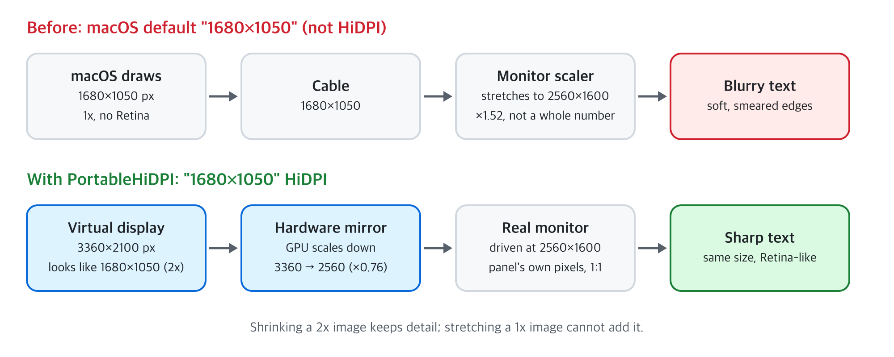

# PortableHiDPI

Sharp HiDPI ("Retina") text on 14–16" portable monitors connected to a Mac. Free, open source, menu bar only.

**한국어 설명서: [docs/manual-ko.md](docs/manual-ko.md)**



## The problem

Plug a 16" 2560×1600 portable monitor into a MacBook and macOS offers two kinds of settings:

- **1280×800 HiDPI** – sharp, but everything is huge.
- **1680×1050, 1920×1200, …** – a comfortable size, but *not* HiDPI. macOS draws 1680×1050 pixels and the monitor stretches them to 2560×1600, so text looks blurry.

What you actually want is "looks like 1680×1050" rendered at 3360×2100 and scaled down to the panel, which is what MacBooks do on their own screens. macOS on Apple Silicon won't offer HiDPI modes larger than the panel, and the old display-override plist trick no longer works there.

You don't need this for 4K monitors: macOS already offers 1920×1080 HiDPI on them.

## Install

Requires macOS 13 or later. Built and tested on Apple Silicon; the universal build also runs on Intel Macs but is untested there.

1. Download `PortableHiDPI.zip` from [Releases](../../releases) and double-click it to unzip.
2. Drag `PortableHiDPI.app` into your **Applications** folder.
3. Double-click it. macOS blocks the first launch because the app is not notarized (that needs a paid Apple Developer account). Click **Done**.
4. Open **System Settings › Privacy & Security**, scroll down to *"PortableHiDPI" was blocked*, click **Open Anyway** and confirm with your password or Touch ID.
5. A display icon appears in the menu bar. The app has no Dock icon.

Steps 3–4 can be replaced by one Terminal command:

```
xattr -dr com.apple.quarantine /Applications/PortableHiDPI.app
```

## Use

1. Connect the monitor and click the menu bar icon.
2. **Monitor Size** – pick your monitor's diagonal. Many portable monitors report a wrong size (the one tested here claims to be 27"), and the size decides which resolution gets the *(recommended)* mark.
3. Pick a resolution, e.g. **1680×1050 HiDPI (recommended)**. The monitor blinks for a second and comes back sharp. Pick a larger number if text is too big, a smaller one if it's too small.
4. Optional: **Refresh Rate** (60 / 120 Hz, on monitors that support it) and **Launch at Login**.

The choice is remembered per monitor and re-applied whenever you reconnect it.

To start the app again after quitting: open it from Applications, or search "PortableHiDPI" in Spotlight (⌘ Space).

### Recommended settings

Targets the same text size as a MacBook's built-in screen (about 125 points per inch).

| Panel | 14" | 15.6" | 16" | Example models |
|---|---|---|---|---|
| 1920×1080 | 1504×846 | 1600×900 | 1600×900 | Most 15.6" FHD portables |
| 1920×1200 | 1504×940 | 1600×1000 | 1600×1000 | Lenovo ThinkVision M16 |
| 2240×1400 | 1504×940 | 1680×1050 | 1680×1050 | Lenovo ThinkVision M14d |
| 2560×1600 | 1504×940 | 1680×1050 | 1680×1050 | ZEUSLAP P16K, LG gram +view, ASUS MB16QHG |
| 2880×1800 | 1504×940 | 1680×1050 | 1680×1050 | 16" OLED portables |
| 3840×2160 | macOS default | macOS default | macOS default | macOS already offers 1920×1080 HiDPI |

Models are examples; check your monitor's panel resolution.

### Troubleshooting

| Symptom | Fix |
|---|---|
| Black borders around the picture | Menu › **Re-apply (fix black borders or blur)** |
| Blurry again after waking from sleep | Wait ~3 seconds (it re-applies automatically), else **Re-apply** |
| An extra "PortableHiDPI …" display in System Settings › Displays | Expected: that's the virtual display. Change resolution from the menu bar app, not there |
| HDR is off | Limitation of mirroring. Choose **Off** when you need HDR |
| Anything else odd | **Quit** – the monitor goes back to its previous mode |

### Uninstall

Turn off **Launch at Login**, quit, and move the app to the Trash. To also remove saved settings: `defaults delete io.github.subbak2.PortableHiDPI`.

## How it works

1. Creates a virtual display offering the HiDPI mode you picked (1680×1050 at 2x = 3360×2100), with CoreGraphics' `CGVirtualDisplay`.
2. Makes the real monitor mirror the virtual display.
3. Sets the real monitor back to its panel resolution (2560×1600). Joining a mirror set makes macOS drive the panel at the virtual display's 3360×2100, which the monitor's scaler shrinks with black borders. The app re-checks this after every display change.
4. The GPU renders at 2x and scales down to the panel, like a MacBook's "More Space" setting, so text stays sharp.

Quitting or choosing **Off** removes the virtual display and restores the monitor's previous mode. Nothing is installed system-wide and no admin password is needed. Before sleep the virtual display is removed, and it's recreated about 3 seconds after wake (mirroring across sleep is fragile in macOS).

## Limitations

- `CGVirtualDisplay` is a **private Apple API**. It has worked since macOS 11 and is used by several display tools, but a macOS update could break it.
- While mirroring, HDR is not available and the monitor runs SDR.
- 120 Hz through a mirrored virtual display can feel choppy on some setups; use 60 Hz if it does.
- Rendering at 2x costs some GPU time and memory (a 3360×2100 frame buffer).

## Command line

```
/Applications/PortableHiDPI.app/Contents/MacOS/PortableHiDPI --list                         # monitors and options
/Applications/PortableHiDPI.app/Contents/MacOS/PortableHiDPI --inches 16 --apply 1680x1050  # set and run
/Applications/PortableHiDPI.app/Contents/MacOS/PortableHiDPI --apply off
```

`--inches` and `--apply` act on the first external monitor and then keep the app running.

## Build from source

```
git clone https://github.com/subbak2/PortableHiDPI.git
cd PortableHiDPI
scripts/build-app.sh          # build/PortableHiDPI.app and build/PortableHiDPI.zip
python3 scripts/make-diagram.py   # redraw docs/images (needs rsvg-convert for PNG)
```

Needs Xcode command line tools (Swift 5.9+). No Xcode project.

## Alternatives

- [BetterDisplay](https://github.com/waydabber/BetterDisplay) – full-featured display manager (free tier + Pro).
- [DeskPad](https://github.com/Stengo/DeskPad) – virtual display shown in a window, handy for screen sharing.

PortableHiDPI does one thing: sharp text on a portable monitor, with nothing else to configure.

## License

MIT
