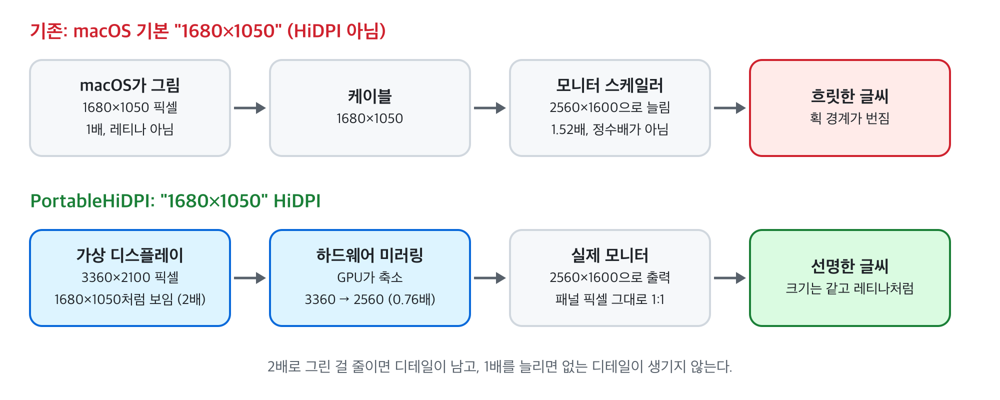

# PortableHiDPI 사용 설명서

맥북에 14~16인치 휴대용 모니터를 연결했을 때 글씨가 흐릿한 문제를 고치는 무료 메뉴바 앱입니다.



## 0. 이런 분께 필요합니다

- 휴대용 모니터를 연결하고 시스템 설정 > 디스플레이에서 1680×1050, 1920×1200 같은 해상도를 고르면 **글씨가 번져 보이는** 경우
- 선명하게 보이는 해상도는 1280×800처럼 **너무 크게 보이는 것 하나뿐**인 경우
- 4K(3840×2160) 모니터는 macOS가 기본으로 1920×1080 HiDPI를 지원하므로 대부분 필요 없습니다

필요한 것: macOS 13 이상, Apple Silicon 맥(M1 이후). Intel 맥에서도 실행은 되지만 테스트하지 않았습니다.

## 1. 내려받기

1. [Releases 페이지](https://github.com/subbak2/PortableHiDPI/releases)에서 최신 버전의 `PortableHiDPI.zip`을 받습니다.
2. 다운로드 폴더에서 zip을 더블클릭해 압축을 풉니다. `PortableHiDPI.app`이 나옵니다.
3. `PortableHiDPI.app`을 Finder 왼쪽의 **응용 프로그램** 폴더로 끌어다 놓습니다.

## 2. 처음 실행하기 (한 번만)

이 앱은 Apple 공증(유료 개발자 계정 필요)을 받지 않아서, 처음 실행할 때 macOS가 막습니다.

1. 응용 프로그램 폴더에서 `PortableHiDPI`를 더블클릭합니다.
2. "Apple은 'PortableHiDPI'에 악성 코드가 없음을 확인할 수 없습니다" 창이 뜨면 **완료**(또는 취소)를 누릅니다.
3. **시스템 설정 > 개인정보 보호 및 보안**으로 가서 아래로 내리면 "'PortableHiDPI'이(가) 차단되었습니다" 옆에 **그래도 열기** 버튼이 있습니다. 누르고 암호(또는 Touch ID)를 입력합니다.
4. 다시 뜨는 창에서 **그래도 열기**를 누릅니다.

터미널이 익숙하다면 아래 한 줄로 2~4단계를 대신할 수 있습니다.

```
xattr -dr com.apple.quarantine /Applications/PortableHiDPI.app
```

실행되면 화면 위쪽 메뉴바에 **모니터 모양 아이콘**이 생깁니다. Dock에는 나타나지 않습니다.

## 3. 모니터 크기 고르기

휴대용 모니터는 자기 크기를 엉뚱하게 알려 주는 경우가 많습니다(테스트한 16인치 모니터는 27인치라고 보고). 크기를 골라 두면 추천 해상도가 정확해집니다.

1. 메뉴바의 모니터 아이콘을 클릭합니다.
2. 모니터 이름 아래 **모니터 크기** 메뉴에서 내 모니터 크기를 고릅니다 (13.3 / 14 / 15.6 / 16 / 17.3 / 18.5인치).

## 4. 해상도 고르기

1. 메뉴에서 **(추천)**이 붙은 해상도를 누릅니다. 16인치 2560×1600 모니터라면 `1680×1050 HiDPI (추천)`입니다.
2. 외장 모니터 화면이 1~2초 깜빡인 뒤 선명해집니다.
3. 글씨가 너무 크면 한 단계 큰 숫자, 너무 작으면 한 단계 작은 숫자를 고릅니다.

모니터별 추천값:

| 패널 해상도 | 14인치 | 15.6인치 | 16인치 |
|---|---|---|---|
| 1920×1080 | 1504×846 | 1600×900 | 1600×900 |
| 1920×1200 | 1504×940 | 1600×1000 | 1600×1000 |
| 2560×1600 | 1504×940 | 1680×1050 | 1680×1050 |
| 2880×1800 | 1504×940 | 1680×1050 | 1680×1050 |

고른 해상도는 모니터마다 기억합니다. 다음에 같은 모니터를 꽂으면 자동으로 다시 켜집니다.

## 5. 주사율 (120Hz 이상 지원 모니터만)

메뉴의 **주사율**에서 60Hz / 120Hz를 고를 수 있습니다. 120Hz에서 화면이 끊겨 보이면 60Hz로 바꾸세요.

## 6. 맥을 켤 때 자동으로 실행하기

메뉴에서 **로그인 시 실행**을 체크합니다. 이후에는 맥을 켤 때마다 앱이 메뉴바에 자동으로 뜨고, 모니터를 꽂으면 저장한 해상도가 바로 적용됩니다.

앱을 종료한 뒤 다시 켜려면 응용 프로그램 폴더에서 `PortableHiDPI`를 더블클릭하거나, Spotlight(⌘+Space)에서 `PortableHiDPI`를 검색해 실행합니다.

## 7. 문제가 생겼을 때

| 증상 | 해결 |
|---|---|
| 화면 둘레에 검은 여백이 생김 | 메뉴의 **다시 적용 (여백·흐림 고치기)** |
| 잠자기에서 깨어난 뒤 다시 흐려짐 | 3초쯤 기다리면 자동으로 다시 켜집니다. 안 되면 **다시 적용** |
| 시스템 설정 > 디스플레이에 "PortableHiDPI ○○" 모니터가 하나 더 보임 | 정상입니다. 앱이 만든 가상 모니터입니다. **해상도는 여기서 바꾸지 말고** 메뉴바 앱에서 바꾸세요 |
| HDR이 꺼짐 | 이 방식의 한계입니다. HDR이 필요하면 **끄기** |
| 오른쪽·아래 가장자리에서 손가락·글자 커서가 안 보임 | 앱이 대신 그려 줍니다(아래 설명). 크기가 다르면 **커서 크기 맞추기** |
| 아예 이상해짐 | 메뉴에서 **종료**하면 원래 해상도로 돌아갑니다 |

### 오른쪽·아래 가장자리에서 커서가 사라질 때

미러링 중에는 macOS가 실제 모니터의 화면 영역을 원래 HiDPI 크기(2560×1600 패널이면 1280×800)로 두는데, 이게 가상 화면(1680×1050)보다 작습니다. 그래서 기본 화살표는 어디서나 보이지만, 링크 위의 손가락 커서나 글자 입력 커서처럼 앱이 바꾸는 커서는 화면 오른쪽·아래 약 4분의 1 구간에서 사라집니다.

PortableHiDPI는 그 구간에서 화살표가 아닌 커서일 때만 커서를 대신 그려 줍니다. 크기는 시스템 설정 › 손쉬운 사용 › 디스플레이의 **포인터 크기**에 맞추고, 포인터 크기를 바꾼 뒤에는 메뉴의 **커서 크기 맞추기**를 누르면 됩니다.

하드웨어가 아니라 앱이 그리는 커서라서 마우스를 약 1프레임 늦게 따라오고, 커서 모양은 0.1초마다 확인해서 손가락↔화살표 전환이 최대 0.1초 늦을 수 있습니다. CPU는 그 구간에서 마우스를 움직일 때만 몇 % 쓰고, 그 밖에서는 쓰지 않습니다.

## 8. 끄기와 삭제

- 잠깐 끄기: 메뉴에서 모니터별 **끄기 (macOS 기본)**
- 완전히 종료: 메뉴의 **종료** (원래 해상도로 돌아갑니다)
- 삭제: 로그인 시 실행 체크를 해제하고 종료한 뒤, 응용 프로그램 폴더에서 앱을 휴지통으로 옮깁니다. 저장된 설정까지 지우려면 터미널에서 `defaults delete io.github.subbak2.PortableHiDPI`

## 9. 개인정보와 보안

- 인터넷에 연결하지 않습니다. 통신 코드가 없고 포트도 열지 않습니다. 메뉴의 "정보…"가 이 페이지를 브라우저로 여는 것이 유일한 링크입니다.
- 관리자 암호, 특수 권한, 시스템 파일 수정이 없습니다. 설정은 앱 자체 설정 파일에만 저장합니다.
- 사용 기록이나 통계를 수집하지 않습니다.
- 배포 앱은 Apple 개발자 인증서 없이 자체 서명(ad-hoc)되어 있고 공증을 받지 않았습니다. 원하면 소스에서 직접 빌드해 쓸 수 있습니다.
- 앱은 이 저장소의 Releases에서만 받으세요. Release마다 zip의 SHA-256 값을 적어 두었으니, 터미널에서 `shasum -a 256 PortableHiDPI.zip` 결과와 같은지 확인할 수 있습니다.

## 10. GPU와 배터리 사용량

화면을 2배 크기로 그린 뒤 줄이기 때문에 GPU를 조금 더 씁니다. 아래 환경에서 직접 잰 값입니다.

- 측정 환경: MacBook Pro M1 Max, macOS 27, 16인치 2560×1600 휴대용 모니터를 1680×1050 HiDPI·60Hz로 연결, 바탕화면을 가만히 둔 상태, `ioreg`의 GPU "Device Utilization" 값

| | GPU 사용률 |
|---|---|
| HiDPI 켬 | 약 5~6% |
| HiDPI 끔 | 약 0.3% |

외장 모니터를 연결하지 않았을 때는 메뉴 막대에 머물러 있기만 해서 CPU는 거의 0%(5초 간격 측정에서 0~1%)이고 GPU 작업은 하지 않습니다. 켜 둬도 부담이 거의 없습니다.

배터리로 쓸 때는 외장 모니터를 연결한 동안 사용 시간이 그만큼 조금 줄어듭니다. 정확한 양은 맥 기종, 해상도, 화면 내용(영상·스크롤은 가만히 있는 화면보다 더 씀)에 따라 다릅니다. 선명한 글씨보다 배터리가 중요하면 전원을 뺐을 때 **끄기**를 고르세요. 내 맥에서 소비 전력(와트)을 직접 재려면 저장소의 `scripts/measure-power.sh`를 `sudo`로 실행합니다.

## 11. 비공개 API를 쓰는 데 따른 위험

PortableHiDPI가 쓰는 `CGVirtualDisplay`는 Apple이 문서로 공개하지 않은 기능입니다. macOS 11부터 계속 들어 있고 다른 디스플레이 앱들도 쓰지만, Apple이 예고 없이 바꾸거나 없앨 수 있습니다.

| macOS 업데이트 후 | 앱 동작 | 할 일 |
|---|---|---|
| 기능이 없어지면 | 앱은 실행되지만 메뉴에 "이 macOS 버전에서는 지원되지 않음"이 뜨고 아무것도 적용하지 않습니다 | 앱 업데이트를 기다리거나 삭제 |
| 동작이 바뀌면 | 켤 때 오류 창이 뜨고, 다시 연결해도 그 설정을 재시도하지 않습니다 | **끄기** 또는 종료 |
| 미러링이 이상해지면 | 검은 여백, 흐림, 외장 화면이 까맣게 나올 수 있습니다 | **다시 적용**, 모니터 뽑기, 종료 |

App Store는 비공개 API를 쓰는 앱을 받지 않기 때문에 이 앱은 GitHub에서만 배포합니다.

## 12. 안전장치와 복구 방법 (벽돌이 되지 않나요?)

하드웨어가 망가지거나 맥이 벽돌이 되는 일은 없습니다. 앱이 하는 일은 가상 모니터를 만들고 현재 로그인 세션의 화면 모드를 바꾸는 것뿐입니다. 펌웨어, 시스템 파일, 모니터 설정에는 아무것도 쓰지 않습니다.

들어 있는 안전장치:

- 맥북 내장 화면은 건드리지 않습니다. 외장 화면에 문제가 생겨도 내장 화면은 그대로 씁니다.
- 화면 설정은 "이번 로그인 동안만" 바뀝니다. 로그아웃하거나 재시동하면 모든 화면이 시스템 설정에서 고른 값으로 돌아갑니다.
- 앱을 종료하거나, 앱이 비정상 종료되거나, 강제 종료해도 macOS가 가상 모니터를 지우고 원래 모드로 되돌립니다.
- 지난번에 설정을 적용하던 도중 앱이 죽었다면, 다음 실행 때는 자동 적용을 하지 않습니다(안전 시작). **Shift**를 누른 채 앱을 실행해도 같습니다.
- macOS에서 비공개 기능이 사라지면 앱이 멈추지 않고 스스로 기능을 끕니다.

외장 화면이 까맣게 되거나 이상해지면 아래 순서로 해 보세요.

1. 메뉴에서 **다시 적용** 또는 **끄기**
2. 메뉴바(내장 화면 위쪽)에서 앱 **종료**
3. 모니터 케이블을 뽑았다가 다시 꽂기
4. 로그아웃 또는 재시동. 로그인할 때 앱이 자동으로 켜지지 않게 하려면 로그인 화면에서 **Shift**를 누른 채 로그인
5. 저장된 설정 지우기: 터미널에서 `defaults delete io.github.subbak2.PortableHiDPI`

## 13. 어떻게 동작하나

4K보다 낮은 외장 모니터에서 macOS는 패널 해상도의 절반 크기 HiDPI 하나만 제공하고, 패널보다 큰 HiDPI 화면은 만들어 주지 않습니다. 2560×1600 패널에서 "1680×1050처럼 보이는 HiDPI"를 쓰려면 3360×2100 크기로 그려야 하는데, 그 모드가 목록에 없습니다.

PortableHiDPI는 그 모드를 가진 **가상 모니터**를 만들고, 실제 모니터가 그 가상 모니터를 **미러링**하게 합니다.

1. 가상 모니터를 3360×2100 픽셀(1680×1050 HiDPI)로 만듭니다.
2. 실제 모니터가 가상 모니터를 미러링하게 합니다.
3. 실제 모니터 출력을 패널 해상도(2560×1600)로 다시 맞춥니다. 미러링을 거는 순간 macOS가 출력을 3360×2100으로 바꿔서 모니터가 검은 여백을 두고 축소하기 때문입니다.
4. GPU가 3360×2100 화면을 2560×1600으로 줄여 보냅니다. 맥북 내장 화면이 "더 넓게" 설정에서 쓰는 것과 같은 방식이라 글씨가 선명합니다.

관리자 암호나 시스템 파일 수정은 필요 없고, 앱을 끄면 가상 모니터도 사라집니다. 다만 Apple이 공개하지 않은 기능(`CGVirtualDisplay`)을 쓰기 때문에, macOS 업데이트 후 동작하지 않을 수 있습니다.
